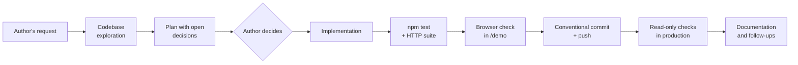

# AI-assisted development

This project was built with **Claude Code** (Anthropic) as a coding agent. This document explains
how the work was divided, which process was followed and what was learned.

- [Division of responsibilities](#division-of-responsibilities)
- [Workflow](#workflow)
- [Project timeline](#project-timeline)
- [Quality safeguards](#quality-safeguards)
- [Bugs caught by the process](#bugs-caught-by-the-process)
- [Lessons learned](#lessons-learned)
- [Facts and figures](#facts-and-figures)

---

## Division of responsibilities

| Human (author) | AI agent |
|---|---|
| Product vision and priorities | Technical design and alternative proposals |
| Decisions that affect how the family uses the app (e.g. password-less profiles, slot-based calendar) | Implementation across server, client and database |
| Validation of every release and of real use at home | Automated tests and browser verification |
| Approval of commits, deployments and configuration changes | Project audits with reasoned scores |
| Household context: schedules, rules, habits | Technical documentation and ADRs |

The agent **does not decide the product**: when a choice changes the family's experience, it is
presented with options and the author decides. Technical decisions are recorded as
[ADRs](adr/) so anyone can review them.

## Workflow

1. **Exploration.** Before changing anything, the agent reads the affected code and its history.
2. **Planning.** Large features start in plan mode: data model, changes per file, tests and
   acceptance criteria. Product decisions are framed as closed questions (for the calendar, for
   example: *time slots or exact hours?*, *weekly template or week by week?*).
3. **Implementation** following the conventions of the existing code.
4. **Three-level verification:** automated tests, a walk through every screen in a real browser
   (mobile and desktop) and read-only checks in production.
5. **Delivery:** a [Conventional Commits](https://www.conventionalcommits.org/) message with
   explicit co-authorship by the agent.

## Project timeline

| Phase | Date | What changed | Why |
|---|---|---|---|
| Prototype | Jun 2026 | Accounts, families and email invitations | First working version |
| PWA | Aug 2026 | Installable app, groundwork for Google Play | Use from the phone |
| Audit and hardening | Aug 2026 | Sanitization, server-side permissions, XSS, streaks, concurrency, demo, tests | An audit of the real state revealed bugs the prototype was hiding |
| Simplification | Sep 2026 | Accounts replaced by four fixed profiles | For a single household, sign-up and passwords were friction with no benefit ([ADR-0003](adr/0003-fixed-profiles-without-accounts.md)) |
| Calendar | Oct 2026 | Schedules, weekly template and planner | Knowing **when** everyone does their chores |
| Reliability | Oct 2026 | Push notifications, three-layer backups, house code, Dependabot | Usage showed forgotten chores: the app had to **remind** people |
| Maintenance | Oct 2026 | Express 5, HTTP tests in CI, AA accessibility | Up-to-date dependencies and verifiable quality |
| Open source | Oct 2026 | Public repository with fictitious data, Render Blueprint, MIT license and documentation | So any family can run it at home |
| Languages | Oct 2026 | Spanish and English per device, including push notifications | Make the app usable beyond a Spanish-speaking home ([ADR-0011](adr/0011-runtime-ui-translation.md)) |

The simplification phase best represents the method: removing code (authentication, email,
tokens) improved the product more than adding it.

## Quality safeguards

- **Pure, tested logic.** Business rules perform no I/O and are tested in seconds.
- **Client code is tested as is**: the `test/_cliente.js` harness runs the script in
  `index.html` in an isolated context, without copying the logic.
- **Mandatory CI** on every change, automated dependency updates included.
- **Visual verification** for every release that touches the interface.
- **Read-only production** during verification: the agent never writes real data.
- **Periodic audits** with a score per module and an explicit list of what is missing.

## Bugs caught by the process

Real cases in which verification found a problem before, or right after, it reached production:

| Problem | How it was found | Fix |
|---|---|---|
| Re-render loop every 4 s | Observed in the browser | Normalize only on the server ([ADR-0004](adr/0004-server-side-normalization.md)) |
| One write for every read | Version increasing without changes in production | `huella()` fingerprint independent of `jsonb` key order |
| A device with the wrong date reset the month | Audit | Cycles decided by the server ([ADR-0005](adr/0005-server-clock.md)) |
| XSS when rendering names | Audit | Systematic escaping |
| Express 5 broke `/demo` | HTTP suite | Route served with `root`; suite added to CI |
| Reminder delivered at 22:31 | Production logs | Server-side time window and five attempts |
| 2:1 contrast ratios | Design review | Palette recalculated to WCAG AA |

## Lessons learned

- **AI speeds up implementation; product judgment remains human.** The best decisions in the
  project (dropping accounts, making the app remind people) came from real use, not from code.
- **Verification is part of the task, not an optional step.** Several bugs only showed up in a
  real browser or against a real PostgreSQL.
- **Invariants get written down.** Every serious bug left a documented rule in
  [ARCHITECTURE.md](ARCHITECTURE.md#invariants) and a test that reproduces it.
- **Fewer dependencies, smaller surface.** With four production dependencies, every update can be
  reviewed.

## Facts and figures

| | |
|---|---|
| Duration | June – October 2026 |
| Code | ~7,800 lines (server, client, SQL and tests) |
| Automated checks | 160 logic + 45 API |
| Production dependencies | 4 |
| Infrastructure cost | €0/month |
| Recorded decisions | 11 ADRs |
