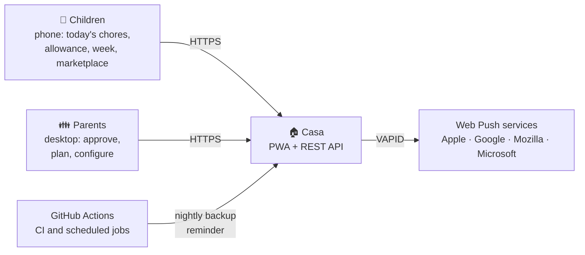
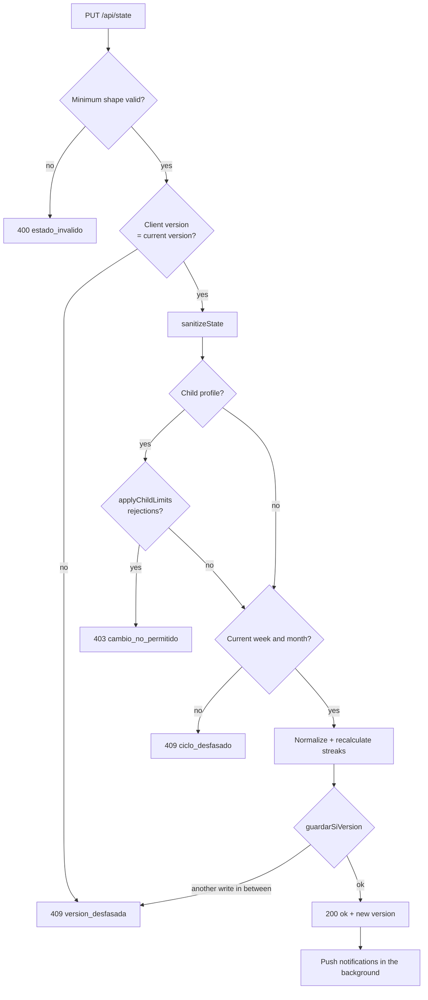
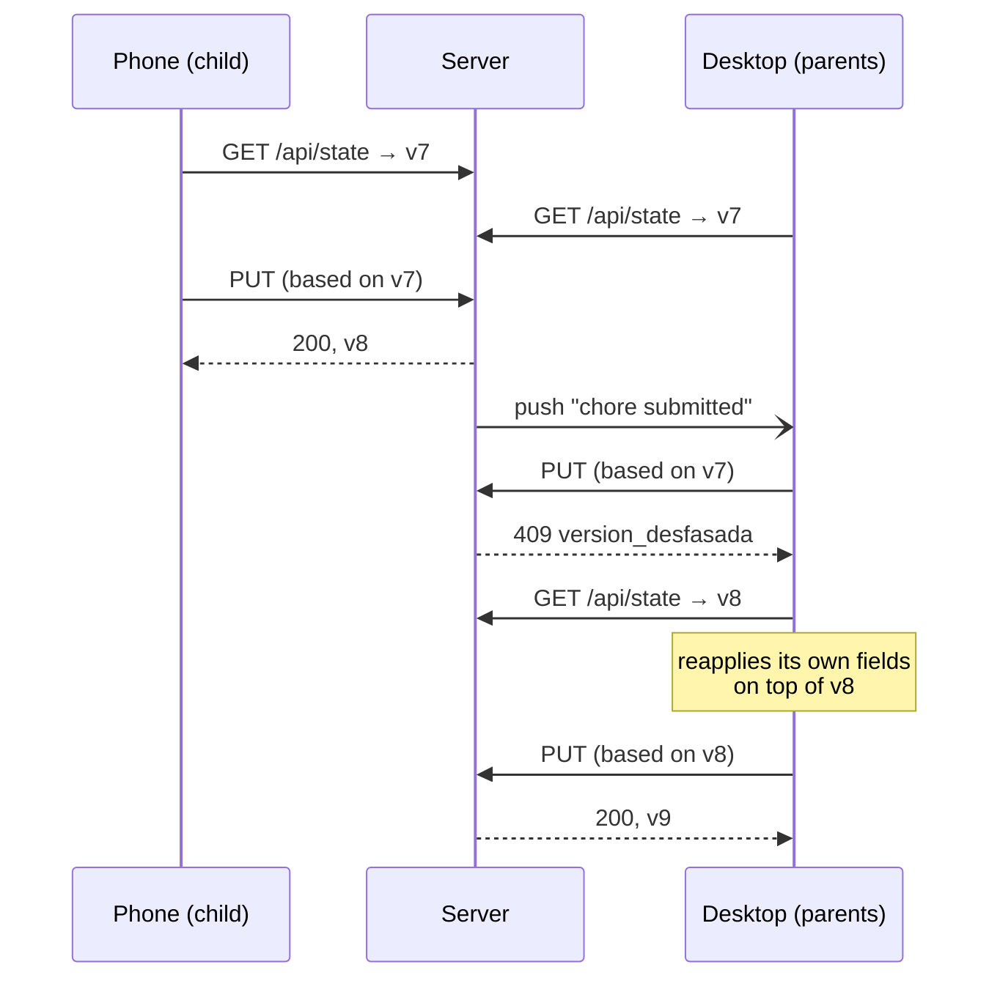
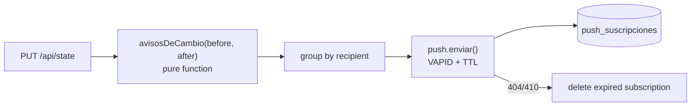

# Architecture

Technical overview of the system: components, responsibilities, the lifecycle of a request,
synchronization between devices and the invariants that must never be broken.

- [Context](#context)
- [Components](#components)
- [Server layers](#server-layers)
- [Request lifecycle](#request-lifecycle)
- [Synchronization between devices](#synchronization-between-devices)
- [The passage of time](#the-passage-of-time)
- [Push notifications](#push-notifications)
- [Backups](#backups)
- [Client](#client)
- [Invariants](#invariants)
- [Quality attributes](#quality-attributes)

---

## Context

One installation serves **a single household**: three child profiles and a parents' dashboard,
four to six devices and a few kilobytes of data. That scale drives the whole design: simplicity,
recoverability and zero infrastructure cost take priority over horizontal scalability.



## Components

| Component | Technology | Responsibility |
|---|---|---|
| **PWA** | Framework-free HTML + CSS + JS (`public/index.html`) | Children's mobile UI and parents' desktop UI; polling and conflict merging |
| **Service worker** | `public/sw.js` | Caches the app shell (never the API) and receives notifications |
| **Profiles** | `public/perfiles.js` (UMD) | Single source of truth for profiles; loaded by the browser (`<script>`) and the server (`require`) |
| **Languages** | `public/i18n.js` (UMD) | Translation engine and catalog; translates the rendered UI in the browser and push notifications on the server ([ADR-0011](adr/0011-runtime-ui-translation.md)) |
| **API** | Express 5 (`server.js`, `routes/`) | Validation, authorization, persistence and orchestration |
| **Domain** | `services/` | Business rules as pure functions: sanitization, cycles, streaks, points, notifications |
| **Persistence** | PostgreSQL 16 | Versioned state document, backups, push subscriptions, metadata |
| **Automation** | GitHub Actions | CI, off-server nightly backup and the daily reminder trigger |
| **Demo** | `public/demo.js` | Replaces the network layer with an in-memory fake server |

## Server layers

```
routes/        HTTP: parsing, status codes, per-route permissions
   │
services/      Pure domain (no I/O)            Data access
   ├── stateGuard.js   sanitization, limits    ├── estadoService.js  versioned read / write
   ├── ciclos.js       week, month, late       ├── copias.js         casa_copias (backups)
   ├── rachas.js       streaks                 └── push.js           subscriptions and delivery
   ├── puntos.js       monthly summary
   ├── avisos.js       what to notify, to whom
   ├── tiempo.js       dates in the household time zone
   └── codigoCasa.js   access code and rate limiting
   │
db/            pg pool and idempotent migrations
```

The rule is that **business logic performs no I/O**: it receives a state and returns another
one (or a list of notifications). That is what allows 160 tests to cover it in seconds, with no
database or network.

## Request lifecycle

### Shared middleware (`server.js`)

1. Security headers: `X-Content-Type-Options`, `X-Frame-Options: DENY`,
   `Referrer-Policy: no-referrer`, `X-Robots-Tag: noindex`, `Strict-Transport-Security`.
2. `express.json({ limit: "4mb" })`.
3. Static files from `public/`.
4. `/api/health` (public).
5. **House-code guard** for the rest of `/api` (when `CODIGO_CASA` is set).
6. Routes → JSON 404 for unknown `/api` paths → final handler (client 4xx errors are returned as
   they are; anything else becomes a 500 without leaking details).

### Read: `GET /api/state`

`leerEstadoAlDia()` ("read the up-to-date state", `services/ciclos.js`) is the only way to read
the state:

1. Reads the row and its version.
2. Saves the **daily backup** if today's does not exist yet (before mutating anything).
3. Translates legacy profiles if there are any (`adoptarPerfiles`).
4. Applies the **week or month rollover** if the server clock says so.
5. Completes the shape of the state (checkboxes, meals, calendar) and recalculates streaks.
6. If anything changed — compared with `huella()`, not `JSON.stringify` — **it persists it**.

### Write: `PUT /api/state`



The order is deliberate: the version check runs **before** the profile rules, so an outdated
device receives a retryable `409` rather than a `403` that would make it lose its change.
Notifications are sent **after** responding, so a slow push service never delays whoever saved.

## Synchronization between devices



- Each client polls every **4 seconds** and re-renders without flicker when there is a new
  version.
- The write is **conditional** (`UPDATE … WHERE version = $n`) and atomic in PostgreSQL.
- On a `409`, the client reapplies the top-level fields it changed on top of the fresh state.
  The merge granularity is the top-level field (see
  [ADR-0002](adr/0002-optimistic-concurrency.md)).
- Per-device state (active profile, open tab, house code) lives in `localStorage`, never in the
  shared document.

## The passage of time

Everything date-dependent is decided by **the server clock** in the `TZ_FAMILIA` time zone
(`services/tiempo.js`); a device with the wrong date cannot move a cycle forwards or backwards
([ADR-0005](adr/0005-server-clock.md)).

| Cycle | Trigger | Effect |
|---|---|---|
| Day | first read of the day | daily backup |
| Week | Monday (`claveSemana`) | fixed-chore checkboxes are cleared; the streak carries over if Sunday was complete |
| Month | 1st of the month (`claveMes`) | anything not submitted becomes *late*, the summary is archived in `history`, assignment and marketplace are cleared; calendar and schedules are kept |
| Afternoon | GitHub Actions, 17:00–21:30 | reminder, at most once a day |
| Night | GitHub Actions, 03:30 | snapshot of the state in the `backups` branch (optional, private repositories only) |

Cycles are applied **lazily** on the first read after they are due, so the server can be asleep
without missing any.

## Push notifications



- `avisosDeCambio` ("notifications for a change") compares the previous and the new state and
  produces targeted events: submission → parents; approval or rejection → child; reward request
  → parents; marketplace request → seller. It **never** notifies whoever made the change.
- `recordatoriosDelDia` builds the evening reminder: to each child, today's planned chores that
  are still pending and any unticked daily chores; to the parents, whatever awaits approval.
- Delivery is idempotent per day through an atomic `INSERT … ON CONFLICT … WHERE` on
  `casa_meta`.
- Only subscriptions whose `endpoint` belongs to a known push service are accepted, so the server
  cannot be used to send requests to arbitrary addresses (SSRF).
- Each subscription stores the device's language, and every notification is translated with the
  shared catalog before delivery (`traducirAviso`).

## Backups

| Layer | When | Retention | Location |
|---|---|---|---|
| Daily | first read of the day | 30 | `casa_copias` |
| Safety | before `reset`, `restore` or restoring a backup | 10 | `casa_copias` |
| Off-site (optional) | every night | one per day | `backups` branch of a private repository |

Every destructive operation saves a backup first, so **any action can be undone by another**.
See [ADR-0009](adr/0009-three-layer-backups.md).

## Client

- A single `index.html` with token-based CSS and JavaScript organized in sections (engine,
  desktop views, mobile views, synchronization).
- Systematic escaping (`esc`, `escColor`) of every piece of state before rendering it.
- `localStorage` only for device preferences (profile, open tab, house code, language).
- **Languages:** UI text is written in Spanish; with another language selected, `i18n.js`
  translates every rendered text node and visible attribute through a `MutationObserver`. Only
  whole-node matches are translated, so household data is never altered
  ([ADR-0011](adr/0011-runtime-ui-translation.md)).
- The service worker never caches `/api`: data is always fresh or explicitly unavailable.
- In `/demo`, `demo.js` intercepts `fetch` and answers from an in-memory state.

## Invariants

Rules that, when broken, produce bugs that have already happened in production:

1. **Normalize only on the server, and persist it.** If the client fixes the shape of the state
   in memory without saving it, every poll detects a difference and the screen enters a
   re-render loop. The client reads with defaults (`S.agenda || []`) and never writes while
   reading ([ADR-0004](adr/0004-server-side-normalization.md)).
2. **Compare with `huella()`.** PostgreSQL (`jsonb`) reorders keys; `JSON.stringify` would report
   two equal objects as different.
3. **Every new state field gets sanitized.** `sanitizeState` is an allow-list: whatever it does
   not sanitize is dropped on save.
4. **No time-based decisions on the client.**
5. **Profile ids are stable.** They are referenced throughout the document; changing one is
   equivalent to erasing that person's history.

## Quality attributes

| Attribute | How it is addressed |
|---|---|
| Integrity | Optimistic concurrency, allow-list sanitization, per-profile limits on the server |
| Recoverability | Three-layer backups and reversible destructive operations |
| Maintainability | Pure, tested domain; four dependencies; an ADR for every relevant decision |
| Cost | €0/month: Render and Neon free plans, GitHub Actions as scheduler |
| Availability | Render cold start (~1 min) accepted; lazy cycles tolerate sleeping |
| Accessibility | WCAG AA contrast, visible focus, reduced motion |
| Portability | PWA installable on iOS and Android; TWA ready for Google Play |
