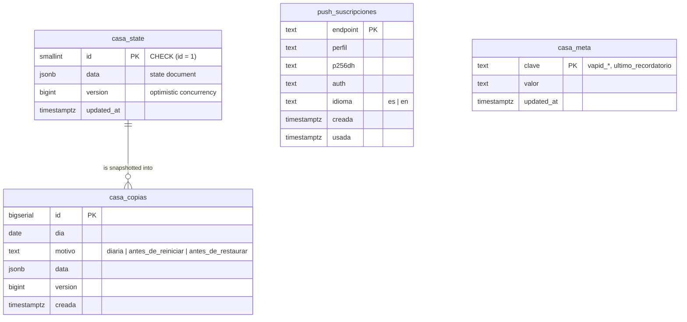
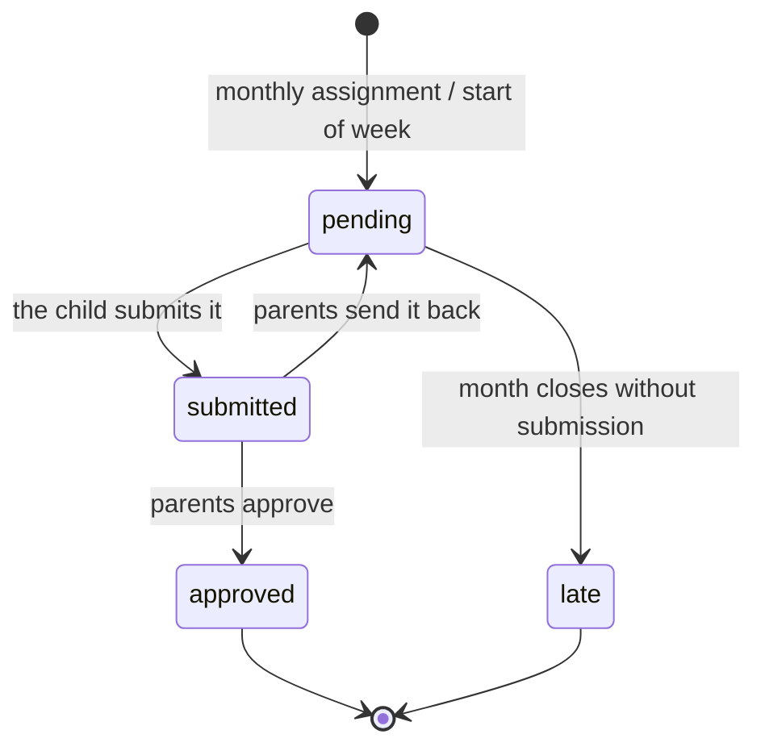

# Data model

The system stores **one JSON document per household** plus three auxiliary tables. The reasoning
behind this design is in [ADR-0001](adr/0001-single-state-document.md).

- [Tables](#tables)
- [The state document](#the-state-document)
- [Document entities](#document-entities)
- [Chore lifecycle](#chore-lifecycle)
- [Sanitization and shape](#sanitization-and-shape)
- [Migrations](#migrations)

---

## Tables



| Table | Rows | Notes |
|---|---|---|
| `casa_state` | 1 | `CHECK (id = 1)` prevents a second household from appearing by mistake |
| `casa_copias` (backups) | ≤ 40 | 30 daily + 10 safety backups. Partial unique index: a single `diaria` backup per day, even under concurrent requests |
| `push_suscripciones` | one per device | Stores the device's profile and language. Deleted automatically when the push service answers `404` or `410` |
| `casa_meta` | a few | Generated VAPID keys and the date of the last reminder (once-a-day guarantee) |

Subscriptions and backups live **outside** the document: they belong to a single device or are
snapshots of the document, and keeping them inside would ship them to every client on every poll.

## The state document

```jsonc
{
  // Current cycle (set by the server)
  "currentWeek": "2026-W44",
  "currentMonth": "2026-10",

  // People
  "members": [ { "id": "…", "name": "…", "role": "child|parent", "color": "#…", "load": "normal|reducida|minima" } ],

  // Economy
  "fixedPay": 8,          // € of fixed weekly allowance
  "rate": 0.05,           // € per point of extra chores

  // Catalogs
  "fixedTasks": [ { "id": "f1", "name": "Make the bed", "icon": "🛏️", "freq": "daily|weekly" } ],
  "extraTasks": [ { "id": "e1", "name": "Clean the bathroom", "points": 40, "icon": "🛁" } ],

  // Weekly progress and monthly assignment
  "fixedState": { "<child>": { "f1": { "days": [true, false, …] }, "f4": { "status": "pending|submitted|approved|late" } } },
  "extras": [ { "id": "…", "taskId": "e1", "memberId": "<child>", "status": "…", "listed": false, "bounty": 0 } ],
  "generated": true,

  // Computed by the server
  "streak": { "<child>": 4 },
  "streakCarry": { "<child>": 3 },
  "history": { "2026-09": { "points": { "<child>": 310 }, "hechas": { "<child>": 12 }, "vencidas": { "<child>": 1 } } },

  // Rewards
  "rewards": [ { "id": "r1", "title": "1 extra hour of screen time", "cost": 60, "type": "Tiempo", "stock": null, "active": true } ],
  "redemptions": [ { "id": "…", "rewardId": "r1", "childId": "<child>", "cost": 60, "status": "pending|approved|denied", "at": 0, "resolvedAt": 0 } ],

  // Sibling marketplace
  "listings": [ … ], "offers": [ … ], "marketLog": [ … ],

  // Meals
  "dishes": [ { "id": "d1", "name": "…", "type": "desayuno|comida|cena", "tags": [] } ],
  "menu": { "Lun": { "desayuno": "", "comida": "", "cena": "" }, … },

  // Calendar (weekly template: never reset)
  "horarios": { "<child>": [ { "id": "…", "label": "School", "days": [0,1,2,3,4], "ini": "08:00", "fin": "14:30" } ] },
  "agenda": [
    { "kind": "fixed", "taskId": "f4", "childId": "<child>", "day": 5, "slot": "manana" },
    { "kind": "extra", "taskId": "e1", "day": 2, "slot": "tarde" }
  ]
}
```

`<child>` is the stable `id` of a child profile defined in `public/perfiles.js`.
`GET /api/state` adds `_version`, which is not stored inside the document.

Glossary of Spanish keys: `horarios` (schedules), `agenda` (weekly plan), `hechas` (completed),
`vencidas` (overdue), `desayuno`/`comida`/`cena` (breakfast/lunch/dinner), `manana`/`tarde`/`noche`
(morning/afternoon/evening slots), `reducida`/`minima` (reduced/minimal availability).

## Document entities

| Field | Owner | Reset | Description |
|---|---|---|---|
| `members` | system | never | The fixed profiles; only `load` (availability) is editable |
| `fixedTasks`, `extraTasks` | parents | never | Catalogs |
| `fixedState` | child (their own) / parents | every Monday | Daily checkboxes (7 days) and status of weekly chores |
| `extras` | parents assign / child submits | every month | Monthly assignment of extra chores |
| `fixedPay`, `rate` | parents | never | Economic parameters |
| `streak`, `streakCarry` | **server** | — | No client can write them |
| `history` | **server** | — | Summary archived when each month closes |
| `rewards` | parents | never | Reward catalog with optional stock |
| `redemptions` | child requests / parents resolve | never | Reward requests; points stay reserved while pending |
| `listings`, `offers`, `marketLog` | children | every month | Marketplace offers, counter-offers and log |
| `dishes`, `menu` | parents | never | Dish database and weekly meal plan |
| `horarios` | parents | never | Each child's busy blocks; every child's key is always present |
| `agenda` | parents | never | Weekly template. Extra chores do not store a child: it is derived from the monthly assignment, so the entry survives the assignment and follows the chore if it changes owner in the marketplace |

## Chore lifecycle



Daily fixed chores have no approval step: each ticked box counts directly.

## Sanitization and shape

- `sanitizeState()` (`services/stateGuard.js`) rebuilds the document field by field from an
  **allow-list**: types, maximum lengths, enums, existing ids and references. Anything unknown is
  dropped.
- `ensureFixedShape()`, `normalizarMenus()` and `normalizarCalendario()` complete the shape on
  the server and the result is persisted, so the client never has to.
- "Has it changed?" comparisons use `huella()` (a fingerprint), which is independent of key order,
  because `jsonb` reorders keys.

## Migrations

`db/schema.js` applies the files in `db/migrations/*.sql` in order at startup. All of them are
idempotent (`CREATE … IF NOT EXISTS`, conditional `DO` blocks).

| Migration | Content |
|---|---|
| 001–007 | Schema of the first version, with accounts and families. No longer used; kept intact |
| 008 | `casa_state` and migration of the state from the accounts version |
| 009 | `casa_meta`, `push_suscripciones`, `casa_copias` |
| 010 | `idioma` (language) column on `push_suscripciones` |

Member ids from the accounts version (UUIDs) are translated into profile ids by
`adoptarPerfiles()`, covered by `test/perfiles.test.js`.
