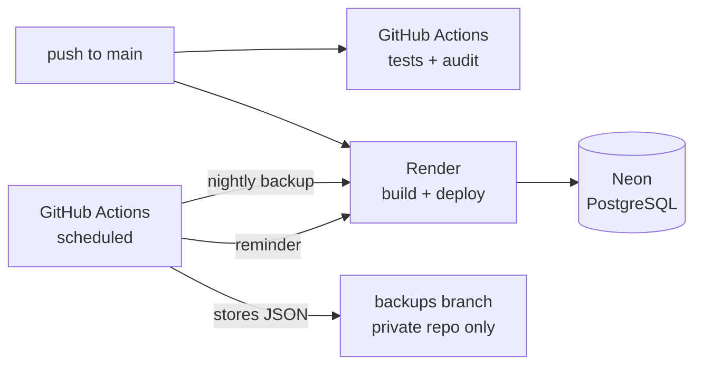

# Operations

Zero-cost infrastructure: **Render** (web server), **Neon** (PostgreSQL) and **GitHub Actions**
(CI and scheduled jobs).

> [!IMPORTANT]
> **The step-by-step guide to set up your own installation is
> [DEPLOY-ON-RENDER.md](DEPLOY-ON-RENDER.md).** This document covers day-to-day operation:
> variables, scheduled jobs, recovery and limits.

- [First deployment](#first-deployment)
- [Variables and secrets](#variables-and-secrets)
- [Scheduled jobs](#scheduled-jobs)
- [Operating the service](#operating-the-service)
- [Disaster recovery](#disaster-recovery)
- [Enabling the house code](#enabling-the-house-code)
- [Android app](#android-app)
- [Free-plan limitations](#free-plan-limitations)

---

## First deployment

Summary of [DEPLOY-ON-RENDER.md](DEPLOY-ON-RENDER.md):

1. **Copy** the repository with *Use this template* and set your household's names in
   `public/perfiles.js`.
2. **Database.** A [Neon](https://neon.tech) project and its *pooled connection string*.
3. **Server.** On [Render](https://render.com), *New → Blueprint* on your copy: it reads
   [`render.yaml`](../render.yaml) and asks for `DATABASE_URL` and `CODIGO_CASA`.
4. **Deploy.** Migrations run automatically at startup.
5. **Check** `https://<service>.onrender.com/api/health` →
   `{"ok":true,"db":true,"protegida":true}`.
6. **GitHub (optional).** `CASA_URL` variable and `CODIGO_CASA` secret to enable the scheduled
   jobs.

From then on, every push to `main` deploys automatically.

## Variables and secrets

### Render

| Variable | Value | Notes |
|---|---|---|
| `DATABASE_URL` | Neon connection string | Required |
| `NODE_ENV` | `production` | |
| `TZ_FAMILIA` | `Europe/Madrid` | Defines when the day, week and month change |
| `CODIGO_CASA` | `npm run codigo` | Strongly recommended for any public deployment; see [below](#enabling-the-house-code) |
| `VAPID_*` | — | Optional; generated and stored in `casa_meta` when missing |
| `ANDROID_FINGERPRINT` | SHA-256 from Play Console | Only when publishing on Google Play |

### GitHub (Settings → Secrets and variables → Actions)

| Name | Type | Used for |
|---|---|---|
| `CASA_URL` | variable | Service URL. **Without it, scheduled jobs do not run** |
| `CODIGO_CASA` | secret | Nightly backup and reminder, when the server has a code |

## Scheduled jobs

| Workflow | Schedule (UTC) | What it does |
|---|---|---|
| `tests.yml` | every push and PR | Logic tests, `npm audit` and the HTTP suite against PostgreSQL |
| `nightly-backup.yml` | `30 2 * * *` | Downloads `GET /api/backup` and stores it in the `backups` branch (`backups/YYYY-MM-DD.json` and `latest.json`). Private repositories only: in a public repository it fails on purpose |
| `evening-reminder.yml` | 5 attempts between 15:07 and 17:19 | `POST /api/push/recordatorios`; the server only acts inside its window and once a day |
| `dependabot.yml` | npm weekly, Actions monthly | Grouped update PRs (minor and patch) |

**Why five attempts.** GitHub delays scheduled jobs at busy times (delays of more than four hours
have been observed). The server discards calls outside 17:00–21:30 and records each delivery
atomically, so the first punctual attempt wins and the rest do nothing.

All of them can be run by hand from *Actions → Run workflow*. A manually triggered reminder
ignores the time window (`FORZAR`), but never sends twice on the same day.

## Operating the service

| Task | How |
|---|---|
| Check that the service is alive | `GET /api/health` |
| See devices with notifications | Parents' dashboard → notifications, or `GET /api/push/estado` |
| Dry-run the reminder | `POST /api/push/recordatorios?simular=1` |
| Download a backup | Parents' dashboard → Economía → download, or `GET /api/backup` |
| Read the logs | Render → Logs (prefixes `[state/put]`, `[push]`, `[copias/…]`) |
| Update dependencies | Merge Dependabot PRs once CI is green |

## Disaster recovery

| Situation | Recovery | Maximum data loss |
|---|---|---|
| Accidental reset or restore | Parents' dashboard → backups → the *before…* backup → restore | none |
| Data corrupted or deleted by an app bug | Most recent daily backup | < 1 day |
| Database lost | New database → deploy → *Restore from file* with `latest.json` from the `backups` branch | < 1 day |
| Render service lost | New Web Service with the same variables | none |

Every restore saves a backup of the current state first, so it can be undone as well.

## Enabling the house code

Without a code, anyone who knows the address can read and change the data. To lock it:

1. `npm run codigo` → e.g. `ABCD-EFGH-JKMN`.
2. Render → `CODIGO_CASA` variable → redeploy.
3. GitHub → `CODIGO_CASA` secret with the same value.
4. Each device receives it once: through a link (`https://<host>/#casa=CODE`, parents' dashboard
   → Economía → Acceso → *Copiar enlace*) or by typing it when the app asks.

The `#casa=…` fragment is never sent to the server, so it never ends up in logs.

## Android app

`casa-android/` contains the configuration of a **Trusted Web Activity** (Bubblewrap): the same
PWA packaged for Google Play. Build instructions in [`casa-android/BUILD.md`](../casa-android/BUILD.md)
and publishing in [`casa-android/PLAY-STORE-GUIDE.md`](../casa-android/PLAY-STORE-GUIDE.md).

## Free-plan limitations

| Limitation | Impact | Mitigation |
|---|---|---|
| Render suspends the service after 15 min without traffic | First load takes up to ~1 min | Lazy cycles; workflows wake the service up |
| No native cron jobs on Render's free plan | The server cannot wake itself up | GitHub Actions as scheduler |
| GitHub Actions delays | The reminder may be skipped on a given day | Five attempts and a time window; alternatively an external scheduler or a paid plan |
